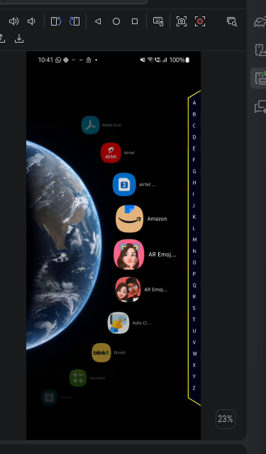

# TGLM-The-Great-Mobile-Launcher
A custom Mobile Launcher for android. Will soon be the top. i hope. i wish. i expect

  

Requirements and build

Running TGML

1. Android 11 or newer. Tested on Android 13 and 15.
2. Download the latest APK from the Releases tab.
3. Install the APK.
4. Set TGML as your default home launcher.

To Build yourself you need:
1. Android Studio
2. Android SDK
3. Emulator or phone with android 13 or newer if you wanna test it
4. USB debugging enabled

Follow these steps:
1. Clone the repo or download zip
2. open project in android studio and allow it to finish sdk and gradle setup
3. connect android phone with usb debugging enabled
4. select it as target
5. click run and there you gp

Set TGML as the launcher
After install android will ask what launcher to use. Select TGML - The Great Mobile Launcher and choose always if you want it to be default

Current Feature List:
1. Scrollable app arc with smooth slowdown
2. Quick jump alphabet bar
3. A cooool background
4. Support to display infinite apps and open them tooo
6. Add your own cooooool (but not as cool) background
7. Choose between 3 intricately designed appscreen layouts, the radial, the proximity magnifier, and the grid scroll
8. Multi page layout
9. Transitions!!!!!!
10. Home Screen!!!
11. multi home screen!!!!!!!!!!!
12. Configurable Home Screen Grid
13. Crosspage dragging of icons
14. drag and drop to delete
15. persistence of shortucts

WIDGETS AND FOLDERS LATEST!!!!!!!!
    
Future possibilities:
INFINITE
widgets and more are priority

**Important**

TGML is currently a development project. The launcher may change significantly between builds, and some features may not work correctly on every Android device.

For development, installing directly through Android Studio is recommended.
